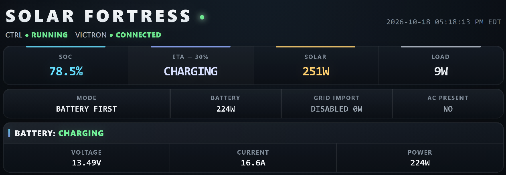

# Solar Fortress

**Solar-first power management for a Victron MultiPlus-II and LiFePO₄ battery system.**

Solar Fortress is a Python controller running on a Raspberry Pi with Victron Venus OS. It monitors battery and inverter state, decides when to run from stored energy or accept utility power, and provides a local dashboard showing what the system is doing.

**Stack:** Python · Raspberry Pi · Venus OS · D-Bus · Victron MK3-USB

  

Live monitoring dashboard from the connected Victron installation.

## Control policy

The system prioritizes battery and solar power. Grid pass-through is the fallback; grid charging is reserved for a deeper battery discharge.

| Condition | Requested operation |
| --- | --- |
| Battery-first, SOC ≤ 30% for 60 seconds | Accept grid pass-through without intentional grid charging |
| Pass-through, SOC ≤ 20% for 60 seconds | Enable grid charging |
| Grid charging, SOC ≥ 30% for 60 seconds | Stop grid charging; remain in pass-through |
| Pass-through, SOC ≥ 35% | Return to battery-first operation |

The separate 30% and 35% thresholds provide hysteresis, preventing mode changes from repeatedly toggling near a single cutoff. Thresholds and qualification times are configurable in [`config/controller.json`](config/controller.json). Actual pass-through requires available AC input.

## How it's built

- **Decision engine:** [`src/controller.py`](src/controller.py) evaluates battery SOC, current operating mode, and qualification timers independently of the hardware interface.
- **Victron integration:** [`src/victron_hardware.py`](src/victron_hardware.py) reads Venus OS D-Bus services and performs verified control writes for supported inverter settings.
- **Runtime:** [`src/solar_fortress.py`](src/solar_fortress.py) executes the control loop, waits for stable startup readings, and reconnects after hardware errors. The command-line entry point defaults to dry-run; `--apply` enables control writes.
- **Monitoring:** [`src/web_dashboard.py`](src/web_dashboard.py) serves the local browser dashboard; `bin/` and `deploy/` contain startup and watchdog scripts.

## Validation and limitations

The control logic is covered by policy and boundary tests, including a simulation sweeping SOC from 0% to 100% in 0.1% increments across the operating modes. GitHub Actions workflows are configured to run these checks without physical Victron hardware.

**Status: experimental.** The dashboard is connected to real equipment, and the repository contains hardware-control code. However, simulated state transitions do not establish safe unattended operation. Hardware-level validation is still needed for communication failures, invalid or stale measurements, AC power changes, and restart or recovery during mode transitions.

This code was developed for one installation, not as a general-purpose drop-in controller. Independent battery management and electrical protections must remain in place. **Software control is not a substitute for hardware safeguards.**

**Network security:** The dashboard currently listens on `0.0.0.0:8080` without authentication. Keep it on a restricted, trusted network; do not expose it directly to the internet.

**Development note:** I defined the operating policy and hardware approach, developed the Python implementation with AI assistance, and tested the control decisions using simulated inputs. Third-party code in `vendor/` is accompanied by its license files.
